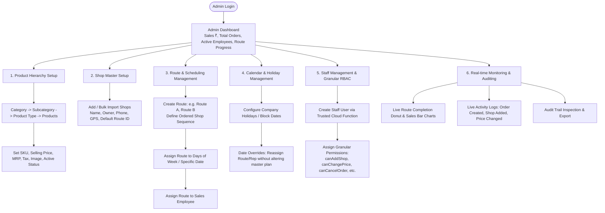
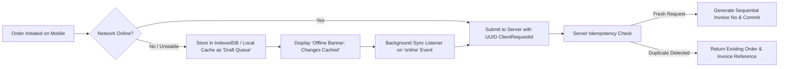

# SALES ON — SYSTEM ARCHITECTURE & MASTER EXECUTION BLUEPRINT (BRAIN)
> **Single Source of Truth (SSOT)** for Product Requirements, Visual Design System, End-to-End System Flows, Data Engineering, Security Rules, Component Architecture, and Step-by-Step Implementation.
> 
> *Synthesized from the 20-Page Product Requirements Document (PRD) and UI Showcases: `Pastel Sales Route App UI Showcase.png` & `Sales On Route Sales UI Showcase.png`.*

---

## 1. Executive Summary & Core Identity

| Attribute | Specification |
| :--- | :--- |
| **Product Name** | **Sales On** (Tagline: *"Your Route. Our Growth"* / *"Your Business, Our Route"*) |
| **Product Category** | Mobile-First FMCG/ITC Route Sales, Van Distribution & Field-Force Management Web Application (PWA) |
| **Primary End-Users** | **Field Sales Executives / Van Sales Representatives** (Primary device: Android smartphones, 360–430px) |
| **Secondary Users** | **Super Admin, Sales Supervisors & Operations Managers** (Primary device: Desktop / Laptop browsers, ≥1024px) |
| **Core Architecture** | Responsive Single Page Application (React 18/19 + TypeScript + Vite) backed by **Google Firebase** (Auth, Firestore, Cloud Functions, Cloud Storage, App Check, Hosting) |
| **Core Value Loop** | `Calendar / Schedule` ➔ `Assigned Route` ➔ `Shop List` ➔ `Order Taking (1-Tap Stepper)` ➔ `Immutable Bill` ➔ `WhatsApp Share` ➔ `Mark Complete / Next Shop` |
| **Guiding Design Principle** | *"A field employee should understand today's route in 3 seconds, take an order with zero typing, and send an official bill on WhatsApp in under 30 seconds with minimal onboarding."* |

---

## 2. Visual Design System & UI Showcase Alignment

Cross-referenced directly with `Pastel Sales Route App UI Showcase.png` (Forest Sage Theme) and `Sales On Route Sales UI Showcase.png` (Indigo Accent Variant):

```
+----------------------------------------------------------------------------------------------------+
|                                    SALES ON DESIGN TOKENS MATRIX                                    |
+-----------------------------------+-----------------------------------+----------------------------+
| Token Category                    | Sage/Forest Baseline (Primary)    | Indigo/Active Accent (Alt) |
+-----------------------------------+-----------------------------------+----------------------------+
| Brand Primary (App Bar / Action)  | #173F35 (Deep Forest Emerald)     | #2E5BFF / #1A365D          |
| Primary Light / Pill Fill         | #E8F1EE (Soft Sage Mint)          | #EEF2FF (Indigo Tint)      |
| Brand Accent                      | #B17A2B (Warm Antique Gold)       | #3B82F6 (Vibrant Blue)     |
| Success / Completed Action        | #059669 / #10B981 (Emerald Green) | #10B981 (WhatsApp / Done)  |
| Warning / Pending Chip            | #F59E0B (Muted Amber)             | #F59E0B (Amber Gold)       |
| Danger / Overdue / Logout         | #EF4444 (Crimson Red)             | #DC2626 (Crimson Red)      |
| Background Canvas                 | #F7F9F8 (Off-White Warm Tint)     | #F8FAFC (Clean Cool Slate) |
| Surface Cards                     | #FFFFFF (Pure White)              | #FFFFFF (Pure White)       |
| Text Primary (Headings / Amounts) | #18201D (Deep Charcoal Green)     | #0F172A (Slate 900)        |
| Text Secondary (Subtitles / SKU)  | #69736F (Muted Stone Gray)        | #64748B (Slate 500)        |
| Borders & Dividers                | #E2E8E5 (Subtle 1px border)       | #E2E8F0 (Slate 200 border) |
+-----------------------------------+-----------------------------------+----------------------------+
```

### Typography, Spacing & Layout Tokens
- **Font Stack**: `Inter`, `Manrope`, or System Sans-Serif (`system-ui, -apple-system, sans-serif`).
- **Touch Target Standard**: Minimum `44px × 44px` on all mobile interactive elements (buttons, quantity steppers, chips).
- **Corner Radii**: Cards = `12px–14px`, Badges/Pills = `9999px` (Full Pill), Primary Buttons = `10px–12px`.
- **Card Styling**: Subtle 1px border (`border-gray-200`), ultra-low elevation shadow (`0 1px 3px rgba(0,0,0,0.05)`). No heavy drop shadows or decorative gradients in transactional screens.
- **Responsiveness Matrix**:
  - `≤ 479px`: Primary Android field screen. Single-column, bottom navigation bar, sticky bottom order bar.
  - `480px – 767px`: Large phones & compact phablets. Relaxed padding, same single-column hierarchy.
  - `768px – 1023px`: Tablets. Two-column split-view (e.g., Shop list on left, Shop details on right).
  - `≥ 1024px`: Desktop Admin Portal. Persistent left sidebar (240px), multi-column analytics, full data tables, modal drawers.

---

## 3. End-to-End System Flowcharts

### 3.1 Field Sales Employee: Daily Order-to-WhatsApp Flow

```mermaid
flowchart TD
    A([Start: Employee Opens App]) --> B{Authenticated?}
    B -- No --> C[Login Screen\nPhone/Email + Password]
    C --> D[Firebase Auth Verify]
    D --> E[Load User Permissions & Profile]
    B -- Yes --> E
    
    E --> F[Home / Today Dashboard\nResolve Date, Holiday & Assigned Route]
    F --> G{Is Today a Holiday?}
    G -- Yes --> H[Display Holiday Notice Card\nRoute Disabled for Today]
    G -- No --> I[Show Route Card: e.g. Route A\nProgress: 3/8 Shops Visited]
    
    I --> J[Navigate to Today's Route Screen]
    J --> K[View Ordered Shop Sequence\n1. Completed | 2. Current | 3. Pending]
    K --> L[Tap Shop Card -> Shop Details Screen]
    
    L --> M{Shop Visit Action}
    M -- Cannot Visit / Shop Closed --> N[Mark 'No Order' or 'Skipped'\nMandatory Reason Prompt]
    N --> K
    M -- Start Order --> O[Take Order / Product Catalog Screen]
    
    O --> P[Filter Categories / Fast Search SKU]
    P --> Q[Tap '+' Stepper to Add Quantities\nSticky Bottom Bar Updates Total ₹ Live]
    Q --> R[Tap 'View Bill' -> Bill Preview Screen]
    
    R --> S[Review Line Items, Rate, Subtotal, GST, Total]
    S --> T[Tap 'Save Order' / 'Confirm Order']
    
    T --> U[Client Pre-Validation & Idempotency Key]
    U --> V[Cloud Function / Transaction: Finalize Order\nAssign Central Invoice # e.g. INV-2026-000125]
    V --> W[Save Immutable Snapshot to Firestore orders/ & visits/]
    
    W --> X[Order Success Screen\nOrder #ORD00125 | Amount ₹120]
    X --> Y{Share Options}
    Y -- WhatsApp --> Z[Open wa.me/91XXXXXXXXXX\nPre-filled Invoice Bill Text & Link]
    Y -- PDF / Print --> AA[Generate & Download PDF Invoice]
    
    Z --> AB[Tap 'Continue to Next Shop']
    AA --> AB
    AB --> K
    K --> AC{All Shops Completed?}
    AC -- Yes --> AD([End of Day Route Complete])
    AC -- No --> L
```

---

### 3.2 Administrator: Setup, Scheduling & Operations Governance Flow



---

### 3.3 Offline Resilience & Idempotent Sync Flow



---

## 4. Screen-by-Screen Blueprint (Cross-Referenced with Showcase Mockups)

### Part A: Mobile Field Screens (Showcase Screens 1 – 7)

#### Screen 1: Login Screen (`/login`)
- **Visual Assets**: Central "Sales On" Brand Logo with Shopping Cart Icon; Tagline: *"Your Route. Our Growth"*.
- **Inputs**:
  - `Username / Phone / Email` text input with user icon prefix.
  - `Password` text input with security lock icon & eye toggle.
  - `Remember me` checkbox.
- **Actions**: Full-width Primary Green/Blue Button (`Sign In`); `Forgot Password?` link.
- **Footer**: Subtle *"Powered by Firebase"* indicator with clean vector illustration.

#### Screen 2: Home Dashboard (`/app`)
- **Top Header**: Hamburger icon (opens drawer), User greeting (`"Good Morning, Ravi Kumar - Sales Executive"` with avatar), Notification bell icon with unread badge.
- **Date & Assigned Route Card**:
  - Date display: `"Today, Mon, 21 Apr 2025"`.
  - Active Route: `"Route A — 3 of 8 shops visited"`.
  - Circular Progress Indicator: `38%` / `56%` visual ring.
- **KPI Stat Row (3 Cards)**:
  1. `Shops`: **8** (Total assigned for today).
  2. `Orders`: **5** (Orders generated today).
  3. `Sales`: **₹24,560** (Total value booked today).
- **Next Shop Shortcut Card**:
  - Store icon, `"Next Shop: Shree General Store (ID: S001)"`, distance (`"1.2 km away"`).
  - Green `"Navigate"` / `"Open Visit"` button.
- **Quick Action Grid**: 4 Icons (`Shops`, `Products`, `Orders`, `More`).
- **Bottom Navigation**: 4 Tabs (`Home` [Active], `Route`, `Orders`, `Profile`).

#### Screen 3: Today's Route Screen (`/app/route`)
- **Header**: Back arrow, Title `"Today's Route"`, Route dropdown/options (`...`), Profile avatar.
- **Date Selector**: Horizontal pill/calendar trigger (`"Mon, 21 Apr 2025"`).
- **Route Meta Banner**: `"Route A • 8 Shops • Assigned to you"`.
- **Ordered Shop Sequence List (Numbered Steps)**:
  - **Item 1 (Completed)**: Step badge `1`, `"Shree General Store"`, `S001 • 9:00 AM`, Green Checkmark circle icon.
  - **Item 2 (Active/Current)**: Step badge `2`, `"Gupta Kirana"`, `S002 • 10:00 AM`, Green/Blue `"Start"` action button.
  - **Items 3 – 6 (Pending)**: Step badges `3, 4, 5, 6`, `"Om Traders"`, `"New Star Mart"`, `"Sri Balaji Store"`, `"Friends General Store"`, Gray `"Pending"` chips.

#### Screen 4: Shop Details & Take Order (`/app/shops/:shopId`)
- **Shop Header Card**: Store image thumbnail, `"Gupta Kirana"`, `Shop ID: S002`, `Active` green badge.
- **Owner Contact Widget**:
  - Owner: `"Ramesh Gupta"`, Phone: `+91 98765 43210`.
  - Action buttons: Quick `"Call"` button & `"Map"` navigation button.
  - Address: `"123, Main Bazaar, MG Road, Surat, Gujarat"`.
- **Tab Bar**: `[Order]` (Active), `[History]`, `[Details]`.
- **Catalog Filter & Search**: Search bar (`"Search products..."`), Filter icon. Horizontal category pills: `[All]`, `[Beverages]`, `[Snacks]`, `[Dairy]`.
- **Product Order Rows**:
  - Product thumbnail, Name, SKU/pack (e.g. `"Coca Cola 750ml"`), Unit Price (`₹40`).
  - **1-Tap Stepper**: `[-]` `[Qty]` `[+]` (High-contrast, 44px touch targets).
- **Sticky Order Summary Bar (Bottom)**:
  - Cart indicator badge: `"3 items | ₹120"`.
  - Action button: `"View Bill"` (Deep Forest Green).

#### Screen 5: Bill Preview & Share (`/app/orders/new/:shopId/preview`)
- **Header**: Back arrow, Title `"Bill Preview"`, `"Edit"` shortcut link.
- **Shop Bill Header**: Shop icon, `"Gupta Kirana"`, `S002 • 21 Apr 2025, 10:15 AM`.
- **Itemized Bill Table**:
  - Columns: `Item | Qty | Price | Amount`.
  - Line 1: `Coca Cola 750ml | 2 | ₹40 | ₹80`.
  - Line 2: `Pepsi 750ml | 1 | ₹40 | ₹40`.
- **Financial Calculation Summary**:
  - `Subtotal`: ₹120.
  - `Discount (0%)`: ₹0.
  - `GST (0%)`: ₹0.
  - `Total Amount`: **₹120** (Bold, prominent).
- **Action Buttons**:
  - Primary: `"Save Order"` (Confirms to Firestore).
  - Secondary: `"Send on WhatsApp"` (wa.me link with bill format).
  - Outline: `"Share PDF"`.

#### Screen 6: Order Success (`/app/orders/:orderId/success`)
- **Visuals**: Animated Green Circle with Checkmark.
- **Confirmation Text**: `"Order Created!"`.
- **Details**: `Order #ORD00125 • Amount: ₹120`.
- **Invoice Card**: Document icon, `"Invoice Ready — View Invoice"`.
- **Primary CTAs**:
  - `"Send on WhatsApp"` (Brand Green button with WhatsApp icon).
  - `"Share PDF"` / `"View Invoice"`.
  - `"Continue to Next Shop ->"` (Proceeds immediately to step 3 in today's route).

#### Screen 7: Hamburger Drawer Menu
- **User Header**: Avatar, Name (`"Ravi Kumar"`), Role (`"Sales Executive"`).
- **Menu Items with Icons**:
  - `Home` (`lucide: home`)
  - `Today's Route` (`lucide: map-pin`)
  - `Shops` (`lucide: store`)
  - `Orders` (`lucide: file-text`)
  - `Products` (`lucide: package`)
  - `Sync Data` (Shows sync status pill / last synced timestamp)
  - `Settings` (`lucide: settings`)
  - `Help & Support` (`lucide: help-circle`)
  - `Logout` (Crimson Red icon & text)
- **Footer**: `Version v1.0.0`.

---

### Part B: Desktop Admin Management Screens (Showcase Screens 8 – 14)

#### Screen 8: Admin Dashboard (`/admin`)
- **Navigation**: Persistent 240px Left Sidebar (`Dashboard`, `Products`, `Shops`, `Routes`, `Employees`, `Orders`, `Calendar`, `Reports`, `Activity Logs`, `Settings`, Admin profile).
- **Top Header Bar**: Search input (`"Search anything..."`), Notification Bell, Help, Admin User Profile switcher.
- **Top Metric Cards (4 KPI Tiles)**:
  1. `Total Orders`: **428** (+12% vs last month).
  2. `Sales Amount`: **₹12,45,300** (+8% vs last month).
  3. `Shops`: **182** (+6% new shops onboarded).
  4. `Employees`: **12** (Active field workforce).
- **Analytics Visualizations**:
  - **Sales Overview Bar Chart**: Grouped bar chart comparing Orders vs Sales (₹) across Monday–Sunday.
  - **Route Completion Widget**: Donut chart (`68%` overall completion) + breakdown (`Completed: 22`, `Pending: 10`).
- **Bottom Two-Column Grid**:
  - **Left: Recent Orders Table**: Order # (`ORD00125`), Shop Name (`Gupta Kirana`), Employee (`Ravi Kumar`), Amount (`₹120`), Status (`Completed` green chip), View All button.
  - **Right: Today's Activity Feed (Live Audit)**:
    - `"Ravi Kumar created order ORD00125 (10:15 AM)"`
    - `"Suresh Patel added new shop (09:30 AM)"`
    - `"New product added - Kurkure 50g (09:10 AM)"`
    - `"Route B updated for Tuesday (08:45 AM)"`

#### Screen 9: Product Management (`/admin/products`)
- **Sub-Tabs**: `[Categories] | [Subcategories] | [Product Types] | [Products]`.
- **Toolbar**: Search bar (`"Search products..."`), Category filter (`"All Categories"`), Status filter (`"All Status"`), `+ Add Product` button.
- **Data Table**:
  - Columns: `Image | Product Name | Category | Type | Price | Status | Action`.
  - Rows: Coca Cola 750ml, Pepsi 750ml, Lay's Classic 52g, Kurkure 50g, Bisleri 1L.
  - Status: Green `Active` badge. Actions: Edit (Pencil), More Options (Three vertical dots).

#### Screen 10: Route & Calendar Management (`/admin/calendar` & `/admin/routes`)
- **Calendar View**: Full monthly grid (April 2025).
- **Color Legend**: `Working Day` (Green dot), `Holiday` (Red dot), `Special Holiday` (Orange dot).
- **Action Buttons**: `< > Month Selector`, `Set Holiday` button, `Assign Route` button.
- **Route Inspection Panel (Right Column)**:
  - Header: `"Route Details • Mon, 21 Apr 2025"`.
  - Assignment: `"Route A • Employee: Ravi Kumar"`.
  - Ordered Shops (6):
    1. Shree General Store (S001)
    2. Gupta Kirana (S002)
    3. Om Traders (S003)
    4. New Star Mart (S004)
    5. Sri Balaji Store (S005)
    6. Friends General Store (S006)

#### Screen 11: Shop Management (`/admin/shops`)
- **Toolbar**: Search input, Filter by Route (`"All Routes"`), Filter by Status (`"All Status"`), `+ Add Shop` button.
- **Data Table**:
  - Columns: `Shop ID | Shop Name | Owner | Phone | Route | Status | Action`.
  - Rows: S001 (Shree General Store), S002 (Gupta Kirana), S003 (Om Traders), S004 (New Star Mart).
  - Actions: `Edit` button.

#### Screen 12: Employee Management (`/admin/employees`)
- **Toolbar**: Search input (`"Search employees..."`), Role filter (`"All Roles"`), `+ Add Employee` button.
- **Data Table**:
  - Columns: `ID | Name | Phone | Role | Routes | Status | Action`.
  - Rows: E001 (Ravi Kumar - Sales Executive - Route A), E002 (Suresh Patel - Sales Executive - Route B), E003 (Pooja Sharma - Manager - All Routes), E004 (Kiran Reddy - Sales Executive - Route C).
  - Actions: `Edit` / Permissions modal.

#### Screen 13: Orders Management (`/admin/orders`)
- **Toolbar**: Date filter (`Today` / `Apr 2025`), Route filter (`"All Routes"`), Search bar.
- **Data Table**:
  - Columns: `Order # | Shop Name | Employee | Amount | Status | Date`.
  - Rows: ORD00125 (₹120, Completed, 21 Apr 10:15 AM), ORD00124 (₹450, Completed), ORD00123 (₹320, Pending).

#### Screen 14: Reports & Analytics (`/admin/reports`)
- **Toolbar**: Period selector dropdown (`"This Month"`).
- **Metric Cards (4 Tiles)**:
  - `Total Sales`: **₹12,45,300**.
  - `Total Orders`: **428**.
  - `Top Product`: **Coca Cola 750ml**.
  - `Top Employee`: **Ravi Kumar**.
- **Visual Breakdown**:
  - Sales by Category Donut Chart: `Beverages (45%)`, `Snacks (25%)`, `Dairy (15%)`, `Others (15%)`.

---

## 5. Granular Security, Role & Permissions Matrix

In strict accordance with PRD Section 4 & Section 14, system capability is governed by a **Base Role + Granular Permission Flags**:

```
+------------------------------+------------+------------------+------------------+
| Capability / Permission Flag | Admin      | Supervisor       | Sales Employee   |
+------------------------------+------------+------------------+------------------+
| canViewAssignedRoutes        | YES        | YES              | YES              |
| canCreateOrderAndBill        | YES        | YES              | YES              |
| canAddShop                   | YES        | YES              | Configurable (T) |
| canEditShop                  | YES        | Conditional (T)  | Own Shops Only   |
| canAddCategory               | YES        | Conditional (F)  | NO               |
| canAddProduct                | YES        | Conditional (F)  | NO               |
| canChangePrice               | YES        | NO (Server Lock) | NO (Server Lock) |
| canCancelOrder               | YES (Must) | Conditional (T)  | NO               |
| canViewTeamOrders            | YES        | Assigned Routes  | NO (Own Only)    |
| canManageRoutes              | YES        | Conditional (F)  | NO               |
| canManageHolidays            | YES        | NO               | NO               |
| canManageUsers               | YES        | NO               | NO               |
| canViewReports               | YES (All)  | Team Scope       | Own Sales Only   |
| canExportData                | YES        | NO               | NO               |
| canViewAuditLogs             | YES (All)  | Team Scope       | NO               |
+------------------------------+------------+------------------+------------------+
```

---

## 6. Complete Firestore Schema Blueprint

All collections follow top-level query-optimized architecture with immutable snapshots for commercial integrity.

### 6.1 `users` (Authentication & RBAC)
```typescript
interface UserDocument {
  uid: string;                    // Firebase Auth UID
  employeeId: string;             // Reference to employees collection e.g. "E001"
  name: string;                   // "Ravi Kumar"
  email: string;                  // "ravi@saleson.com"
  phone: string;                  // "+919876543210"
  role: 'super_admin' | 'admin' | 'supervisor' | 'sales_employee';
  status: 'active' | 'suspended';
  assignedRouteIds: string[];     // ["route_a", "route_b"]
  permissions: {
    canAddShop: boolean;
    canEditShop: boolean;
    canAddCategory: boolean;
    canAddProduct: boolean;
    canChangePrice: boolean;
    canCancelOrder: boolean;
    canViewTeamOrders: boolean;
    canManageRoutes: boolean;
    canManageHolidays: boolean;
    canManageUsers: boolean;
    canViewReports: boolean;
    canExportData: boolean;
  };
  createdAt: FirebaseFirestore.Timestamp;
  updatedAt: FirebaseFirestore.Timestamp;
}
```

### 6.2 `products` & Catalog Hierarchy (`categories`, `subcategories`, `productTypes`)
```typescript
interface CategoryDocument {
  id: string;                     // "cat_beverages"
  name: string;                   // "Beverages"
  code: string;                   // "BEV"
  status: 'active' | 'inactive';
  createdBy: string;              // UID
  createdAt: FirebaseFirestore.Timestamp;
}

interface ProductDocument {
  id: string;                     // "prod_coca_cola_750"
  sku: string;                    // "CC-750ML"
  name: string;                   // "Coca Cola 750ml"
  categoryId: string;             // "cat_beverages"
  subcategoryId?: string;         // "subcat_carbonated"
  productTypeId?: string;         // "type_soft_drinks"
  unit: string;                   // "Bottle" / "Pack" / "Box"
  sellPrice: number;              // 40.00 (Authoritative Base Price)
  mrp: number;                    // 40.00
  taxRate: number;                // 0.00 (0% or 18% GST)
  imageUrl?: string;              // GCS path or public web URL
  active: boolean;                // true
  createdBy: string;
  createdAt: FirebaseFirestore.Timestamp;
  updatedAt: FirebaseFirestore.Timestamp;
}
```

### 6.3 `routes` & `routeSchedules`
```typescript
interface RouteDocument {
  id: string;                     // "route_a"
  code: string;                   // "R-A"
  name: string;                   // "Route A - Surat Central"
  area: string;                   // "MG Road / Main Bazaar"
  orderedShopIds: string[];       // ["shop_s001", "shop_s002", "shop_s003"]
  defaultWeekdays: number[];      // [1, 3, 5] (1=Mon, 3=Wed, 5=Fri)
  active: boolean;
  createdAt: FirebaseFirestore.Timestamp;
}

interface RouteScheduleDocument {
  id: string;                     // "sched_2025-04-21_route_a"
  dateString: string;             // "2025-04-21" (YYYY-MM-DD)
  routeId: string;                // "route_a"
  employeeId: string;             // "E001"
  overrideType?: 'normal' | 'reassigned' | 'holiday_cancelled';
  status: 'active' | 'cancelled';
}
```

### 6.4 `shops` (Store Master)
```typescript
interface ShopDocument {
  id: string;                     // "shop_s002"
  shopCode: string;               // "S002"
  name: string;                   // "Gupta Kirana"
  ownerName: string;              // "Ramesh Gupta"
  phone: string;                  // "+919876543210"
  alternatePhone?: string;        // "+919876543211"
  address: string;                // "123, Main Bazaar, MG Road"
  city: string;                   // "Surat"
  state: string;                  // "Gujarat"
  geo?: {
    latitude: number;
    longitude: number;
  };
  routeId: string;                // "route_a"
  status: 'active' | 'inactive';
  createdBy: string;              // UID of Employee or Admin
  createdAt: FirebaseFirestore.Timestamp;
  updatedAt: FirebaseFirestore.Timestamp;
}
```

### 6.5 `visits` (Daily Shop Execution)
```typescript
interface VisitDocument {
  id: string;                     // "visit_2025-04-21_shop_s002"
  dateString: string;             // "2025-04-21"
  routeId: string;                // "route_a"
  shopId: string;                 // "shop_s002"
  employeeId: string;             // "E001"
  status: 'pending' | 'started' | 'order_placed' | 'no_order' | 'skipped' | 'completed';
  outcomeReason?: string;         // e.g. "Shop Closed", "Stock Already Full"
  orderId?: string;               // "ord_2026_000125"
  startedAt?: FirebaseFirestore.Timestamp;
  completedAt?: FirebaseFirestore.Timestamp;
}
```

### 6.6 `orders` (Immutable Commercial Snapshot)
```typescript
interface OrderLineItemSnapshot {
  productId: string;
  sku: string;
  productName: string;
  unit: string;
  qty: number;
  unitPrice: number;              // Snapshot at moment of sale
  discountPercent: number;
  discountAmount: number;
  taxRate: number;
  taxAmount: number;
  lineTotal: number;
}

interface OrderDocument {
  id: string;                     // "ord_2026_000125"
  orderNo: string;                // "ORD00125"
  invoiceNo: string;              // "INV-2026-000125"
  idempotencyKey: string;         // Client UUID prevents duplicate submits
  dateString: string;             // "2025-04-21"
  
  // Snapshots for bulletproof audit integrity
  shopId: string;
  shopCodeSnapshot: string;
  shopNameSnapshot: string;
  shopPhoneSnapshot: string;
  
  employeeId: string;
  employeeNameSnapshot: string;
  
  routeId: string;
  routeNameSnapshot: string;
  
  items: OrderLineItemSnapshot[];
  
  subtotal: number;               // e.g. 120.00
  discountTotal: number;          // 0.00
  taxTotal: number;               // 0.00
  grandTotal: number;             // 120.00
  
  status: 'completed' | 'cancelled';
  cancelReason?: string;
  cancelledBy?: string;
  
  notes?: string;
  whatsappShared: boolean;
  createdAt: FirebaseFirestore.Timestamp;
  finalizedAt: FirebaseFirestore.Timestamp;
}
```

### 6.7 `auditLogs` (Immutable System Trail)
```typescript
interface AuditLogDocument {
  id: string;
  actorUid: string;               // User UID
  actorName: string;              // "Ravi Kumar"
  action: 'ADD_SHOP' | 'ADD_PRODUCT' | 'UPDATE_PRODUCT_PRICE' | 'FINALIZE_ORDER' | 'CANCEL_ORDER' | 'UPDATE_PERMISSIONS' | 'CREATE_HOLIDAY';
  entityType: 'shops' | 'products' | 'orders' | 'users' | 'holidays' | 'routes';
  entityId: string;               // Record reference
  details: Record<string, any>;   // before/after or payload snapshot
  timestamp: FirebaseFirestore.Timestamp;
}
```

---

## 7. Cloud Functions & Trusted Server Logic

1. **`finalizeOrder(data, context)`**:
   - Validates user authentication & active session.
   - Re-checks authoritative product prices from `products/` collection to prevent client-side price manipulation.
   - Executes a Firestore transaction to generate sequential invoice number (`INV-YYYY-XXXXXX`).
   - Writes `orders/`, updates `visits/` to `order_placed`, and logs to `auditLogs/` atomically.
2. **`createStaffAccount(data, context)`**:
   - Ensures caller has `canManageUsers` permission.
   - Calls Firebase Admin Auth SDK to provision user credentials without exposing private keys to browser.
   - Creates corresponding document in `users/` and `employees/`.
3. **`cancelOrder(data, context)`**:
   - Verifies caller has `canCancelOrder` permission and non-empty `cancelReason`.
   - Transitions order status to `cancelled` and marks reason; preserves snapshot data for historical audit.
4. **`shareWhatsAppTemplate(orderId)`**:
   - Formats localized message payload:
   ```text
   *SALES ON — OFFICIAL ORDER RECEIPT*
   Invoice No: INV-2026-000125
   Shop: Gupta Kirana
   Date: 21 Apr 2025, 10:15 AM
   -----------------------------
   1. Coca Cola 750ml x 2 = ₹80
   2. Pepsi 750ml x 1 = ₹40
   -----------------------------
   Total Bill Amount: ₹120.00
   
   View / Download Digital Invoice:
   https://saleson.web.app/invoice/ORD00125
   Thank you for your business!
   ```

---

## 8. Firestore Security Rules Blueprint

```javascript
rules_version = '2';
service cloud.firestore {
  match /databases/{database}/documents {
    
    // Helper functions
    function isAuthenticated() {
      return request.auth != null;
    }
    
    function getUserData() {
      return get(/databases/$(database)/documents/users/$(request.auth.uid)).data;
    }
    
    function isAdmin() {
      return isAuthenticated() && (getUserData().role in ['admin', 'super_admin']);
    }
    
    function hasPermission(perm) {
      return isAuthenticated() && (isAdmin() || getUserData().permissions[perm] == true);
    }

    // Products: All authenticated users can read; only permitted users can modify
    match /products/{productId} {
      allow read: if isAuthenticated();
      allow create, update: if hasPermission('canAddProduct');
      allow delete: if isAdmin();
    }
    
    // Categories, Subcategories, ProductTypes
    match /{catalogs}/{docId} {
      allow read: if isAuthenticated();
      allow write: if hasPermission('canAddCategory') || isAdmin();
    }

    // Shops: All authenticated can read; create requires canAddShop
    match /shops/{shopId} {
      allow read: if isAuthenticated();
      allow create: if hasPermission('canAddShop');
      allow update: if hasPermission('canEditShop') || isAdmin();
      allow delete: if isAdmin();
    }

    // Routes & Schedules & Holidays
    match /routes/{routeId} {
      allow read: if isAuthenticated();
      allow write: if hasPermission('canManageRoutes') || isAdmin();
    }
    match /routeSchedules/{scheduleId} {
      allow read: if isAuthenticated();
      allow write: if hasPermission('canManageRoutes') || isAdmin();
    }
    match /holidays/{holidayId} {
      allow read: if isAuthenticated();
      allow write: if hasPermission('canManageHolidays') || isAdmin();
    }

    // Visits: Employees can update their own daily shop visits
    match /visits/{visitId} {
      allow read: if isAuthenticated();
      allow create, update: if isAuthenticated();
    }

    // Orders: Immutable client writes; deletions forbidden
    match /orders/{orderId} {
      allow read: if isAuthenticated();
      allow create: if isAuthenticated(); // Prefer Cloud Function finalization
      allow update: if hasPermission('canCancelOrder') || isAdmin();
      allow delete: if false; // Commercial records can never be hard-deleted!
    }

    // Audit Logs: Append-only via server or privileged action; No client updates/deletes!
    match /auditLogs/{logId} {
      allow read: if hasPermission('canViewAuditLogs') || isAdmin();
      allow create: if isAuthenticated();
      allow update, delete: if false;
    }
    
    // Users: Users can read their own profile; only admin can write
    match /users/{userId} {
      allow read: if isAuthenticated() && (request.auth.uid == userId || isAdmin());
      allow write: if isAdmin();
    }
  }
}
```

---

## 9. Comprehensive Frontend Component Hierarchy

```
src/
├── app/
│   ├── App.tsx                   # Main Provider root (Auth, Query, Router)
│   ├── routes.tsx                # Role-aware routing & route guards
│   └── index.css                 # Master Design tokens & typography
├── layouts/
│   ├── MobileShell.tsx           # Top App Bar + Hamburger Drawer + Bottom Nav
│   └── AdminShell.tsx            # 240px Persistent Left Sidebar + Top Bar
├── components/
│   ├── common/
│   │   ├── Button.tsx            # Primary, Secondary, Outline, Danger variants
│   │   ├── StatusChip.tsx        # Completed (Green), Pending (Amber), Inactive (Gray)
│   │   ├── QuantityStepper.tsx   # [-] [qty] [+] 44px touch targets
│   │   ├── SearchInput.tsx       # Real-time debounce search
│   │   ├── Modal.tsx             # Accessible dialog overlays
│   │   ├── DataTable.tsx         # Sortable, paginated desktop tables
│   │   └── OfflineBanner.tsx     # Reconnecting / Offline warning pill
│   ├── field/
│   │   ├── ShopCard.tsx          # Step number, shop name, distance, status, Start CTA
│   │   ├── ProductCatalogItem.tsx# Thumbnail, name, pack size, price, stepper
│   │   ├── OrderSummaryBar.tsx   # Sticky bottom counter (items, ₹ total, View Bill)
│   │   └── BillPreviewTable.tsx  # Itemized invoice receipt breakdown
│   └── admin/
│       ├── KPITile.tsx           # Stat counter with delta trend (+12%)
│       ├── SalesBarChart.tsx     # Orders vs Sales comparison
│       ├── RouteCompletionDonut.tsx # Radial / donut progress
│       ├── CalendarGrid.tsx      # Monthly view with status dots (work/holiday)
│       └── ActivityTimeline.tsx  # Real-time audit log stream
├── features/
│   ├── auth/                     # LoginPage, AuthContext, ForgotPassword
│   ├── employee-home/            # HomeDashboard, RouteCard, QuickActions
│   ├── route-execution/          # RouteShopList, ShopDetailView, VisitStatus
│   ├── order-taking/             # ProductCatalogView, BillPreview, OrderSuccess
│   ├── admin-dashboard/          # AdminDashboardView, QuickStats
│   ├── product-management/       # ProductsTable, CategoryTabs, AddProductModal
│   ├── shop-management/          # ShopsTable, AddShopForm, GeoPicker
│   ├── route-management/         # RoutesList, RouteOrderingDnd, RouteCalendar
│   └── reports-audit/            # ReportsView, AuditLogViewer
├── services/
│   ├── firebase.ts               # Firebase App, Auth, Firestore, Functions Init
│   ├── authService.ts            # Sign-in, sign-out, session persistence
│   ├── catalogService.ts         # Categories, subcategories, products caching
│   ├── routeService.ts           # Daily schedule resolver, route shops
│   ├── orderService.ts           # Order submission, invoice sequence, local drafts
│   └── auditService.ts           # Immutable activity logger
└── types/
    └── index.ts                  # Shared TypeScript interfaces & types
```

---

## 10. Step-by-Step Implementation Roadmap

```
+----------------------------------------------------------------------------------------------------+
|                               PHASED SYSTEM IMPLEMENTATION ROADMAP                                 |
+---------+----------------------------+-------------------------------------------------------------+
| Phase   | Milestone Name             | Core Deliverables & Verifications                           |
+---------+----------------------------+-------------------------------------------------------------+
| Phase 1 | Foundation & Design System | - Vite + React 18/19 + TypeScript initialization            |
|         |                            | - Master Tailwind / CSS Design Tokens (Sage #173F35)        |
|         |                            | - MobileShell (Bottom Nav) & AdminShell (Sidebar)           |
|         |                            | - Firebase Authentication & Role-Based Route Guards         |
+---------+----------------------------+-------------------------------------------------------------+
| Phase 2 | Master Catalogs & Data     | - Category, Subcategory, Product Type & Products CRUD       |
|         |                            | - Shop Master with Route Association & Duplicate Checks     |
|         |                            | - Route Master with Ordered Shop Sequences                  |
|         |                            | - Calendar & Holiday System with date override resolution   |
+---------+----------------------------+-------------------------------------------------------------+
| Phase 3 | Employee Field Experience  | - Employee Home Screen with Date, Route & KPI Counters      |
|         |                            | - Today's Route Ordered Shop List with Step Badges          |
|         |                            | - Shop Detail View with Call / Map Shortcuts                |
|         |                            | - Product Catalog with Fast Search & 1-Tap Quantity Stepper |
+---------+----------------------------+-------------------------------------------------------------+
| Phase 4 | Billing & WhatsApp Engine  | - Sticky Bottom Order Bar with live amount calculations     |
|         |                            | - Bill Preview Screen (Items, Rates, Subtotal, GST, Total)  |
|         |                            | - Server Order Finalization & Sequential Invoice Generator  |
|         |                            | - Order Success Screen & wa.me WhatsApp Deep-Link Share     |
+---------+----------------------------+-------------------------------------------------------------+
| Phase 5 | Admin Intelligence Portal  | - Admin Analytics Dashboard (KPIs, Sales Bar Chart, Donut)  |
|         |                            | - Interactive Route & Calendar Scheduler                    |
|         |                            | - Staff Management & Granular Permission Editor             |
|         |                            | - Live Audit Log Activity Feed & Export Filter              |
+---------+----------------------------+-------------------------------------------------------------+
| Phase 6 | Resilience & Deployment    | - IndexedDB Offline Draft Queue & Auto-Sync Listener        |
|         |                            | - Firestore Security Rules & Emulator Verification Suite    |
|         |                            | - PWA Manifest, Service Worker & Mobile Viewport Audit      |
|         |                            | - Firebase Hosting Production Pipeline Deployment           |
+---------+----------------------------+-------------------------------------------------------------+
```

---

## 11. Verification Checklist & Quality Gates

1. **Mobile Experience (360px – 430px)**:
   - [ ] No horizontal scrolling on Android screen sizes.
   - [ ] All interactive touch targets (buttons, steppers, chips) measure at least `44px × 44px`.
   - [ ] Sticky bottom order bar does not obstruct bottom navigation or content.
2. **Speed & Usability**:
   - [ ] Product catalog quantity increment/decrement reacts instantaneously without UI lag.
   - [ ] Product search responds in `< 100ms` with client-side index/cache.
3. **Data & Commercial Integrity**:
   - [ ] Changing a product price in Admin does not modify historical items in previously finalized orders.
   - [ ] Duplicate order submission is prevented via UUID idempotency key.
   - [ ] Invoice numbers follow a unified sequential format (`INV-YYYY-XXXXXX`).
4. **Field Communication**:
   - [ ] WhatsApp button initiates `wa.me` with validated shop phone and formatted order text only after order is successfully persisted.
5. **Security & Permissions**:
   - [ ] Non-admin users cannot access `/admin/*` routes or perform privileged operations.
   - [ ] Direct URL tampering or unauthorized Firestore queries are denied by default.

---
*Created and maintained as the foundational brain for the SALES ON route-sales application.*
